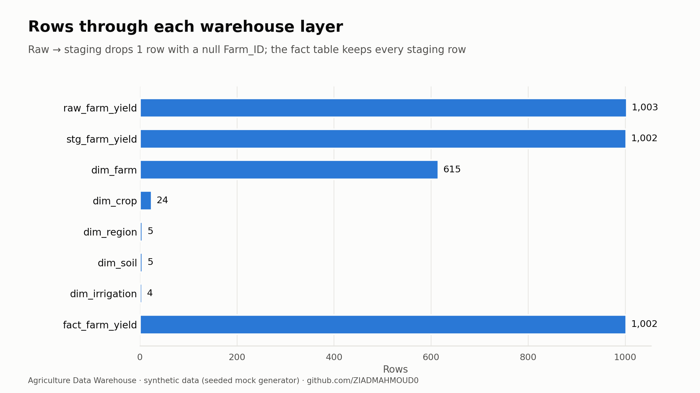
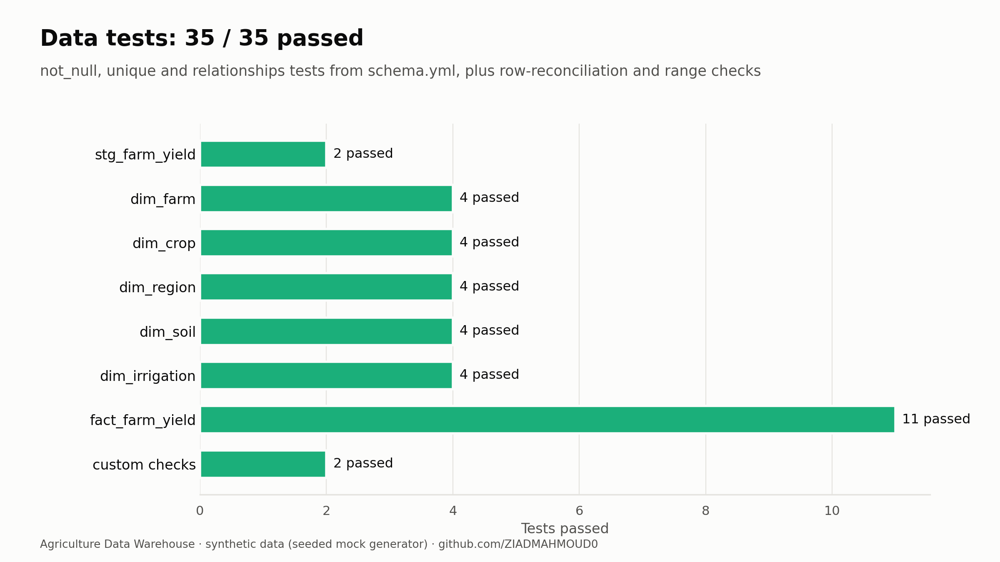
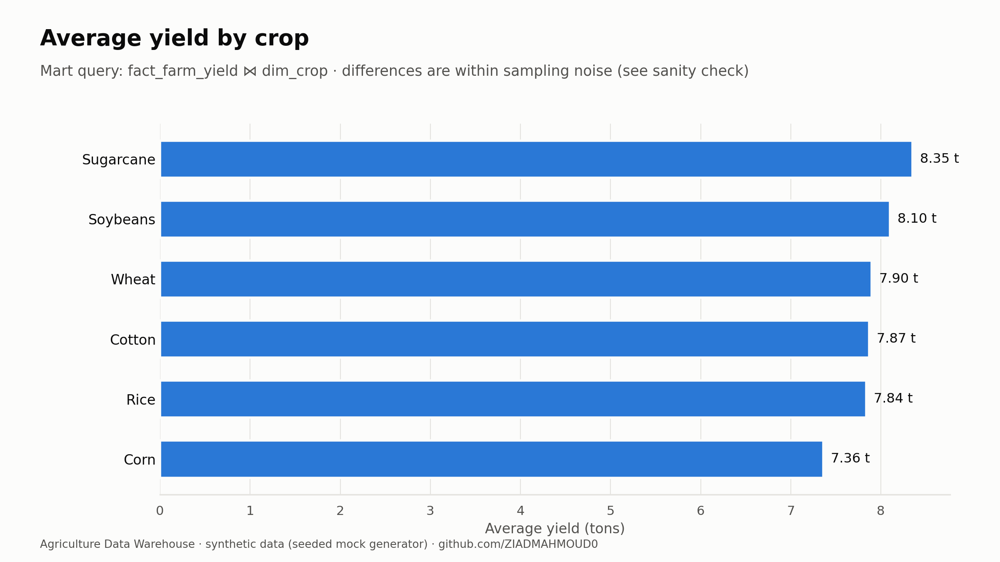
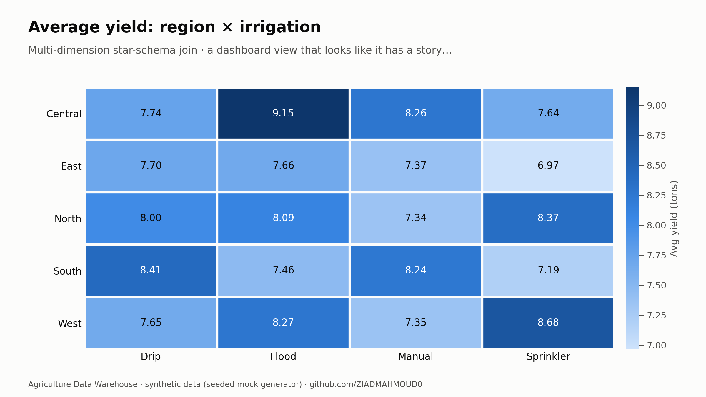
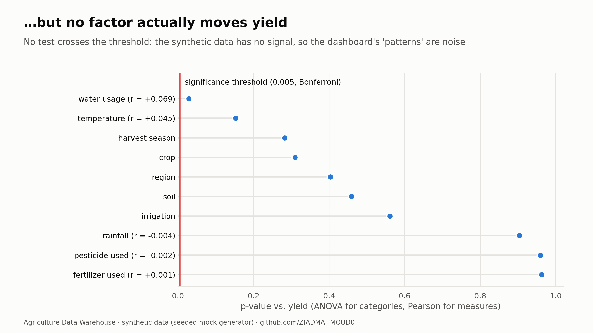

# 🌾 Agriculture Data Warehouse Pipeline

An ingestion-to-reporting data warehouse for farm-yield data: **Apache NiFi** moves incoming CSVs into **SQL Server**, **dbt** builds a staging layer and a star schema, **Apache Airflow** (Dockerized) orchestrates the run, and **Power BI** reports on the mart.

- **Runnable notebook on Kaggle:** [Agriculture DWH: Star Schema & Data Tests](https://www.kaggle.com/code/ziadmahmoud1310/agriculture-dwh-star-schema-data-tests) — the same transformations and tests, reproduced in SQLite so they run in the browser.

> **Data note:** the pipeline runs on **synthetic** data from [`scripts/generate_mock_data.py`](scripts/generate_mock_data.py) (seeded, 1,000 rows), not real agricultural measurements. The project is about the pipeline and data quality, not agronomy.

## Architecture

```
CSV files ──► Apache NiFi ──► SQL Server [raw] ──► dbt [stg] ──► dbt [mart] ──► Power BI
(data/incoming)  GetFile →      raw.farm_yield       stg_farm_yield   star schema
                 PutDatabaseRecord                    (view)          (tables)
                        ▲                                ▲
                        └──────── Apache Airflow DAG (Docker) ────────┘
                           start NiFi GetFile → dbt run → stop NiFi GetFile
```

| Layer | Tool | Detail |
|---|---|---|
| Ingestion | Apache NiFi 2.x | `GetFile` → `PutDatabaseRecord` loads CSVs into `raw.farm_yield` |
| Warehouse | SQL Server | Three schemas: `raw`, `stg`, `mart` ([setup scripts](sql/setup)) |
| Transformation | dbt (`dbt-sqlserver`) | Staging view with cleaning and type casts, plus a star schema with 5 dimensions and 1 fact |
| Orchestration | Apache Airflow 2.9 (Docker) | [DAG](airflow/dags/dwh_pipeline_dag.py) starts and stops NiFi through its REST API (JWT auth) and runs dbt |
| Reporting | Power BI | [`powerbi/agriculture_dwh.pbix`](powerbi/agriculture_dwh.pbix), connected to the `mart` schema |

## Star schema

| Model | Grain | Key |
|---|---|---|
| `fact_farm_yield` | One row per yield observation | FKs to all dimensions |
| `dim_farm` | One row per farm | `farm_key` |
| `dim_crop` | One row per crop × harvest season | `crop_key` |
| `dim_region` | One row per region | `region_key` |
| `dim_soil` | One row per soil type | `soil_key` |
| `dim_irrigation` | One row per irrigation type | `irrigation_key` |

Staging ([`stg_farm_yield.sql`](dbt_agriculture/models/staging/stg_farm_yield.sql)) trims and upper-cases the text fields, casts the numeric fields, renames columns with their units, and drops rows that have no `Farm_ID`.

## Data quality

[`schema.yml`](dbt_agriculture/models/marts/schema.yml) declares `not_null`, `unique` and `relationships` tests on every model. The Kaggle notebook runs them, adds row-reconciliation and range checks, and then injects defects to confirm the tests catch them.




## Reporting and a sanity check




Before reading a story into these views, test whether the differences are real. In the generator, yield is independent of every factor, and after a Bonferroni correction no factor comes out significant:



## Run it locally

**Prerequisites:** SQL Server (with ODBC Driver 17), Apache NiFi 2.x, Docker, and Python 3.11.

1. **Database:** create the `AgricultureDWH` database. Set a password in [`sql/setup/00_create_admin_user.sql`](sql/setup/00_create_admin_user.sql), then run both setup scripts.
2. **NiFi:** build a flow with `GetFile` watching `data/incoming/` and `PutDatabaseRecord` writing to `raw.farm_yield`.
3. **Sample data:** `python scripts/generate_mock_data.py` writes `data/incoming/farm_yield_data.csv`.
4. **Airflow:**
   ```bash
   cd airflow
   cp .env.example .env    # fill in NiFi credentials, DBT_PASSWORD and a Fernet key
   docker-compose up airflow-init
   docker-compose up -d
   ```
   Open http://localhost:8081 and trigger `agriculture_dwh_pipeline`.
5. **Tests:** `cd dbt_agriculture && dbt test --profiles-dir .` (with `DBT_PASSWORD` set)
6. **Power BI:** open the `.pbix` and click **Refresh**.

## Project structure

```
├── airflow/            # Dockerfile, docker-compose, DAG, .env.example
├── dbt_agriculture/    # dbt project: staging + marts models, schema tests
├── sql/setup/          # SQL Server login, schemas and raw tables
├── scripts/            # mock data generator
├── notebook/           # Kaggle notebook (SQLite reproduction + tests)
├── charts/             # exported charts
├── powerbi/            # Power BI report
└── data/incoming/      # NiFi drop folder
```

## Tech stack

Apache NiFi · SQL Server · dbt · Apache Airflow · Docker · Power BI · Python · pandas · SQLite
